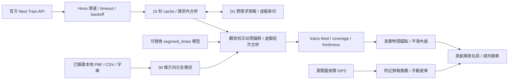
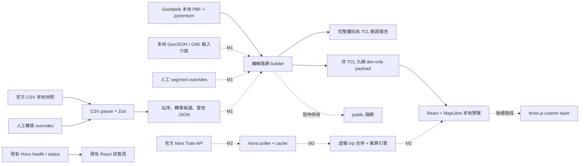

# 香港港鐵即時列車地圖：架構與設計

狀態：**十線玩具城市、官方預報位置推算、代表車款玩具及逐架跟車已實作。位置與班次身份不是 GPS 或實際車號。**
不以舊版靜態 SVG 網站當作已完成的 MapLibre 路網。此 repo 位於 `/workspace/harbour-rail`，與舊版 Sites source 分開。

## 2026-11-18：官方預報位置推算與選車

官方／模擬兩種資料模式、逐架選車、GPS 附近推薦與代表車款玩具模型已加入；以 LIVE.md 為現行規格，舊章節中的「M2 尚未實作／只有官方看板」為歷史狀態。Next Train 沒有 GPS、車號或班次實際車款；所有位置、virtual ID、模型站間時間與班次合併均標推算，預報不能保證真車同秒抵達。

EAL timeType／timetype 差異、RAC 字典新增身份、Cache API 邊界、240/min per-isolate 上限及無 GPS 誤差驗證見 LIVE.md。新增 build-live.ts 只讀本地資料，網絡只在運行時經後端查官方 API。

## 2026-11-17 立體玩具城市及 TCL 最新決定

使用者確認東涌線行駛新走線、要求補回並將新站標為未開通。只在 relation 5317704 將尾端三條 ways 1176509649→1558652644→1558652643 放回 1558652640 與 1558652637 之間；完整原始 member sequence 受 guard 約束，四個接點同源 node ID 10930801895／10930801903／13238819880／10931051406，無新幾何、無最近鄰接線。其餘 gap 警告維持審核用途，不再阻擋此指定路徑。十線 120 站鍵／97 站碼，12 條玩具路徑。

東涌東／西保留原始 construction station node，置於獨立 upcomingStations，status=not-open；沒有官方站碼、不查 API、不計入已開站數。東涌西沒有提供可用已核實營運連線，僅標源點，不補線。

視覺由「普通底圖上的幾個玩具」改成完整 diorama：專用 MapLibre toyStyle、波浪海面、粉彩主幹道、three.js instanced 積木樓群、凸粒屋頂、樹木、山丘、公園、具名 OSM 地標原創模型、玩具道路高架，以及枕木＋雙鋼軌。OSM footprint 重心屬計算錨點，所有模型尺寸與高度明示 inferred / decorative-not-survey；不把美術地形當實測座標或地面層級。資料流程：已驗證本地 PBF → extract-toy-city.py → toy-city.json（Zod 驗證）→ CityScenery custom layer；不連網建置。

下文保留過往里程碑記錄；相衝的九線／TCL 暫停／production 無資料說明由本節與 PRODUCT.md 取代。官方資料及模擬車仍明確分開。

## 最新產品決定：港鐵玩具城

使用者已要求直接交付成品、所有產品決定由代理處理，不再逐項批准。現以 docs/PRODUCT.md 的兒童玩具城市方案為準；下文 dev-only 發佈暫停為歷史階段，不再阻止九線玩具產品部署。來源限制仍保留：TCL 未核實路徑不使用，不將模擬列車當真實車次。

UI 現改採已讀取的 VoltAgent Figma 模板之 pastel 色塊、圓角及 pill 語彙；暖 cream/mint、深綠可讀文字、原創列車造型與 three.js 場景。操作以兒童的探索、跟車、收藏為主，資料字典及來源資訊置於家長資訊頁。

部署以單一 Hono Worker 供應 Vite 資產與官方到站 proxy。地圖玩具動作保持模擬標示，官方到站預報獨立顯示；非完整真實 trip 推算模型。具體快取／限速／資料定義見 PRODUCT.md。

## Milestone 1 更新（2026-11-17）：九線開發預覽，發佈暫停

使用者已批准 TML:SUW↔OSM SWT，僅 nodes 2308404918、2308405006。`station-ref-overrides.json` 同時約束線路、官方碼、OSM ref 和 node ID，記錄使用者依據的 Next Train v1.6 字典及站圖檔名 suw.pdf，source/reason 必填。原始碼雙方保留；沒有全域 alias 或容錯。全量已恢復 120／120 鍵，單元測試驗證其他 key/ref/node 不受豁免。

TCL relation 5317704 **未批准重排**。ways 1176509649、1558652644、1558652643 依使用者決定標記 uncertain-construction，從所有線路網絡及動畫 member lists 排除；原始排序報告仍保存兩處 gap。全 PBF direct memberships、五條 way 完整 tags、bbox、長度、最近原站點、附近其他 track 幾何比較、gap 端點距離見 [tcl-extension-check.md](tcl-extension-check.md)。不自行判定營運狀態，不以日期或其他 relation 引用作結論。

新的本地建置有三個輸出邊界：

1. **審核**：全量站鍵、原始 routes、status uncertain ways、warnings、TCL check 等存 data/reports，供核對；不當可發佈網絡。
2. **開發預覽**：773 features、112 線路站鍵／96 站碼，僅非 TCL 九線；data/reports/development-map.json（Git 忽略），Vite configureServer 的 /__dev/map 提供，never import 入 bundle。
3. **public**：一直停用，無 public/data 輸出或部署。Vite production build／vite preview 不含資料 middleware，前端離開 dev 會顯示本機預覽限制。使用者之後確認前不可解除。

已知 TCL gaps（僅已記錄的兩組 source IDs）作警告保留；新 gap 或新 ref 衝突仍 exit 2，刪除舊 dev payload。這不是「全部錯誤都忽略」。TCL 所有動畫 routes 標 review-held／usableForAnimation=false。

layer 的 312 個缺欄與 17 個相對層級均 unknown，inferred=true/basis 保留，不補地面分類。MapLibre 圖層統一樣式，不用透明度暗示地面類型。原 116 個多平台配對照舊，新增 SUW 後總數 117；保留原 sourceNodeId 及 alternatives，UI 不稱官方站中心，配對關係標推斷。

每個 feature 與 dev payload 都加 colour_source=osm-unverified；等待使用者官方色表前不宣稱官方色碼。42 對轉乘候選未確認，全部不當轉乘。所有發佈及資料來源決定詳見 [source-review.md](source-review.md)。

UI 延續原 Linear 深色 tokens：sidebar 篩選／搜尋、地理底圖、原始車站點、可關閉資訊卡、鏡頭旋轉／傾斜與雙語切換。OpenFreeMap dark 向量底圖含來源 attribution；本地 OSM 資料另有署名。九線預覽不包含任何列車。桌面及手機 screenshot／QA 見 verification.md，軟件 WebGL 不代表真手機效能驗收。

## 目標與邊界

以官方 CSV 建立可追溯的站序與身份資料，以開放空間資料建立軌道拓撲。未取得或未核對的資料不補估。將來列車位置一律顯示「推算」，不可把虛擬 trip ID 稱為港鐵車號。

目前有九線 MapLibre 本地開發預覽、Hono health/status、離線 CSV/PBF 審核、schemas、來源例外與測試。three.js 尚未建立 custom layer；Location Service、PWA service worker 及到站 API poller 未實作。TCL 和正式發佈保持暫停。

## 架構

`apps/web`：React / Vite；`apps/api`：Node / Hono；`packages/shared`：跨層型別和 Zod schemas；`scripts/lib`：可測試的離線資料處理；`data/raw`：不可修改的來源快照；`data/reports`：可重新生成的審核與阻塞報告。

開發環境 Vite 將 `/api` 代理至 localhost:8787；Hono CORS 只允許設定的 WEB_ORIGIN。瀏覽器不直接呼叫官方到站 API。正式部署方式尚未選擇，這次沒有修改已部署 Sites 網站。

## 資料流與身份

1. 官方 CSV 快照 → 欄位集合檢查 → Zod 每列驗證 → 排除全空紀錄 → 按線路及 Direction 以 Sequence 排序。
2. 車站主鍵固定為 `(Line Code, Station Code)`，字串表示為 `TCL:HOK`。原始 Station ID 只作線路內來源欄位，既不是跨線合併鍵，也不是列車識別碼。
3. 同一站的多方向資料合併入主鍵物件；站序獨立保存在 route，route key 為 `(Line Code, Direction)`。CSV 每列自然唯一性為主鍵加 Direction。重複序號、重複紀錄及同鍵 metadata 衝突直接報錯。
4. 轉乘**候選**只自動比對 Station Code 及 NFC／去空白後的中文名；同碼異名或同名異碼輸出警告，不做模糊字詞、距離或 Station ID 推斷。候選不等於已核實的轉乘通道。
5. 跨碼關係需要 `data/interchange-overrides.json` 明確寫出完整成員、reason、source。人工群組優先，會從自動群組中移出所列成員；因此要保留同站所有線路，必須列出完整成員。未知站鍵、重複群組 ID、重複成員及跨人工群組重疊均報錯。
6. 香港／中環不能因距離或例子自動合併；九龍／九龍塘也沒有任何自動轉乘假設。所有 overrides 初始均為空，等待核實。
7. 分支使用實際 Direction token。EAL：UT/DT、LMC-UT/LMC-DT；TKL：UT/DT、TKS-UT/TKS-DT。CSV 的康城分支只包含調景嶺—將軍澳—康城；不擅自延長至北角。UT/DT 與 Next Train 的方向欄位對應尚未驗證。
8. 東涌線／機場快綫保留各自站序與軌道 ID，不能因共站直接共享整條線形。屯馬線保留完整雙向 27 站序列。未驗證空間拓撲前，不宣稱共線或分支已無錯接。

## Milestone 2：到站倒數 → 虛擬 trip 合併初稿

以下是待資料字典與真實 fixtures 驗證的設計，並非已實作模型。沒有官方 GPS 或車號可驗證真實列車身份。

1. 先閱讀指定 Next Train 資料字典，確認 status、delay、curr_time/sys_time、方向、dest、ttnt、valid 等欄位存在與語意，將原始資料保存，再映射至內部 Observation。不可假設 CSV UT/DT 就等於 API UP/DOWN。
2. Observation 應含來源抓取時間、官方資料時間、line、station 主鍵、已驗證方向、dest、預計到站時間及誤差區間。ttnt 是倒數觀測，不是穩定的身份鍵；缺少欄位、過期或無效回應不當成空班次。
3. 利用已驗證的路網與 dest 枚舉可達 route。分支、終點及短途班次限制候選路徑；無法唯一確定時保留歧義，不跨羅湖／落馬洲或寶琳／康城強行合併。
4. 每輪按 `(line, verified direction, compatible route/dest)` 匹配既有虛擬 trip。成本包括預計到站時間差、站序連續性、segment_times 累計差、資料時間差及分支不相容懲罰；一個觀測最多配對一個 trip，匹配需維持同一路徑的列車先後次序，避免超車造成身份互換。
5. `segment_times.json` 使用有方向的相鄰站鍵與來源／版本。目前缺少經核實的站間時間，不能填隨機預設。未達匹配門檻的資料先作暫定候選，多輪連續支持後才建立內部 `virtualTripId`；不把 seq、月台或 dest 當車號。
6. 運動狀態機：加速 → 巡航 → 減速 → 停站。停站 20–40 秒僅為使用者指定的可配置模型範圍，不是港鐵實測結論。沿已驗證 polyline 的弧長進度移動，終點封頂，不穿越錯誤分支。
7. 新觀測校正以有界速度平滑追趕，正常速度的 0.5–2 倍屬設計限制；不可瞬移或為趕進度越過下一站／終點。太大殘差應標示低信心並重新匹配，而非靜默換車。停止狀態的校正不能用零速乘數，需獨立有界起步模型。
8. 資料中斷時 UI 顯示「資料中斷／推算中」，保留最後官方資料時間，有限時間外推後淡出。外推期限、淡出期限、匹配容許誤差需透過 fixtures 校正，現在不當作已驗證值。
9. 後端分批、全域限速、同鍵 in-flight 合併、TTL cache、timeout、指數退避及 jitter。最終頻率需要官方限制與可用性核實；M0 官方 Next Train 請求數為 **0**。過期 cache 明確標示，不用 HTTP 成功代表資料新鮮。
10. 評估以觀測殘差、trip 壽命、短命候選、位置／速度跳變、重複 trip 率、分支違規和中斷狀態測試為主。預報間一致性不等於 GPS 真實誤差；沒有 GPS ground truth 時不得宣稱定位準確到某米。

## 路網幾何資料來源與阻塞

### 今輪實際結果

2026-11-16 UTC；只執行一輪；同一 User-Agent `hk-mtr-live/0.1 (+CONTACT_EMAIL_NOT_PROVIDED)`，聯絡電郵仍待使用者提供。POST form body 傳 Overpass QL，bbox 固定 `(22.15,113.80,22.57,114.45)`，依 route type 分拆；一次只發一個請求，沒有改 UA 或繞過服務限制。

| Endpoint                                | 請求       | HTTP／結果                       |
| --------------------------------------- | ---------- | -------------------------------- |
| overpass-api.de/api/interpreter         | subway     | 503；上游連線逾時                |
| overpass.private.coffee/api/interpreter | subway     | 無 HTTP 回應；curl 28，50 秒逾時 |
| overpass.kumi.systems/api/interpreter   | subway     | 無 HTTP 回應；curl 28，50 秒逾時 |
| z.overpass-api.de/api/interpreter       | subway     | 200；54 個 relation              |
| z.overpass-api.de/api/interpreter       | light_rail | 200；31 個 relation              |
| z.overpass-api.de/api/interpreter       | train      | 502；容量及佇列已滿              |

train 失敗後停止，沒有執行 stations 查詢，也沒有再輪詢 endpoint。沒有遇到 429；腳本已實作遇到 429 後等至少 30 秒並遵守更長 Retry-After 的分支，但未在真服務上觸發測試。完整查詢、抓取日期、HTTP 狀態、錯誤和原始回應見 `data/raw/overpass-*`、`docs/overpass-audit.md`。

這是**部分取得、整輪不完整**，不能寫成「全部沒有資料」，亦不能寫成「全港路網已完成」。由於已有部分成功，本輪未啟動 CSDI 網絡後備查找，沒有猜測任何 endpoint。

### 實際缺口與下一步

- subway 回應包含十條重鐵線的 ref，但一條線可能有多個短途／方向／特別服務 relation；例如 EAL 23 個 relation。不能隨便選第一個或用 ref 合併所有幾何。
- relation `out body geom` 只有 relation-level tags 及 member geometry；沒有獨立 way tags。因此目前無法逐段核對 tunnel、bridge、layer，亦沒有完整 station node tags 支援 Station Code 對應。
- railway=station／stop 節點未取得；不能將 relation member 的順序或最近座標當作已驗證的車站配對。
- 尚欠已核對的 member ways/nodes、停站碼對應、服務方向與分支路徑，以及共享線段的拓撲測試。若使用者提供本地 OSM 匯出或已核實空間檔案，才能繼續。
- `scripts/build-network.ts` 是**阻塞預檢入口**，只讀本地檔案、寫 `data/reports/network-blockers.json` 後以 exit 2 停止；不會生成 network.geojson/stations.json，也不會在 build 期間連網。一般 `npm run build` 驗收 M0，不呼叫這個阻塞入口。
- 已預留 `loadLocalSpatialInput`：接收含來源 URL、授權 URL、日期、CRS、欄位映射及 `data/raw/` 內路徑的 manifest，讀取本地 GeoJSON 或安全解析 GML。這只是輸入介面，不是完整 CSDI 轉換器；GML feature 結構、軸序、EPSG:2326 轉換及線路欄位要先看實際檔案，未核對時拒絕／阻塞，不猜欄位。測試中的 example.com 僅為合成 fixture，並非資料來源。
- 若往後完全無法取得 OSM，人工需從 [CSDI Portal](https://portal.csdi.gov.hk/csdi-webpage/) 確認鐵路中線圖層名稱、實際 WFS／ArcGIS REST endpoint、座標系統、欄位字典及授權條款，才可啟動對應 adapter。

### 分段 layer 規則（已實作、尚無完整輸入）

使用 tunnel、bridge、layer 推斷，一律 `inferred: true`。tunnel 與 bridge 同時為真時保留 unknown；只有 layer 數值時屬相對層級弱推斷，必須標示待核對；無標籤不默認地面。`data/segment-overrides.json` 可按來源段 ID 覆蓋，須附 source/reason，人工結果為 `inferred: false`。尚未有經核實的段 ID，不預填 overrides。

## 風險與驗證

| 風險               | 影響                         | 控制／驗證                                                                         |
| ------------------ | ---------------------------- | ---------------------------------------------------------------------------------- |
| 資料授權           | CSV、OSM、圖磚與模型權利不同 | 個別來源、授權、日期及署名留存；OSM ODbL 不被程式碼授權取代；模型／商標另核對      |
| API rate limit     | 全站輪詢可能過量、被限流     | M2 前核對官方限制；全域請求上限、合併、TTL、退避；README 記錄實際策略              |
| 幾何與轉乘誤配     | 錯接分支、連錯站、穿地       | 不猜配對；離線快照、人工 overrides、拓撲斷點與分支測試                             |
| 方向／trip 歧義    | 幽靈車、重複車、身份互換     | 字典核對、真 fixtures、單對單約束、信心與殘差、過期淡出                            |
| OSM bbox／標籤缺漏 | 抽取不完整或含額外服務       | 保存實際 tags；bbox 是篩選而非幾何裁剪；逐一核對 members，不假設都有 operator/ref  |
| 3D 效能            | 手機 GPU／耗電、context loss | 先以 2D marker 驗證；後續 instancing、LOD、可見區裁剪、低效能降級與 reduced-motion |
| 車款資料準確度     | 每線多款車、調配變更         | 來源與適用日期必備；不宣稱每班虛擬 trip 車款已知；缺證據用一般幾何體               |
| PWA cache 過期     | 離線舊資料看似即時           | 分離 app shell 與資料 freshness；未來 service worker 不隱藏中斷狀態                |
| 定位與隱私         | 權限拒絕、座標不準           | 未來只在使用者操作後要求位置；本地計算附近車站、顯示誤差，不儲存定位               |

## 視覺與無障礙

延續舊版採用的 [VoltAgent Linear 設計分析](https://github.com/VoltAgent/awesome-design-md/blob/main/design-md/linear.app/DESIGN.md)（MIT）：near-black #010102、surface #0f1011、border #23252a、文字 #f7f8f8、次文字 #8a8f98、focus #828fff；4px spacing、8px controls、12px panels。只沿用設計語彙，未使用 Linear 商標或專有字型。
繁體中文為預設，已有英文切換；44px 觸控按鈕、鍵盤 focus、語言屬性及狀態訊息。2026-11-17 已完成 Chromium 的桌面／手機 viewport 截圖及互動 QA；使用軟件 WebGL，不宣稱真實手機硬件效能。其餘歷史 M0 未完成描述不代表本輪預覽狀態。
